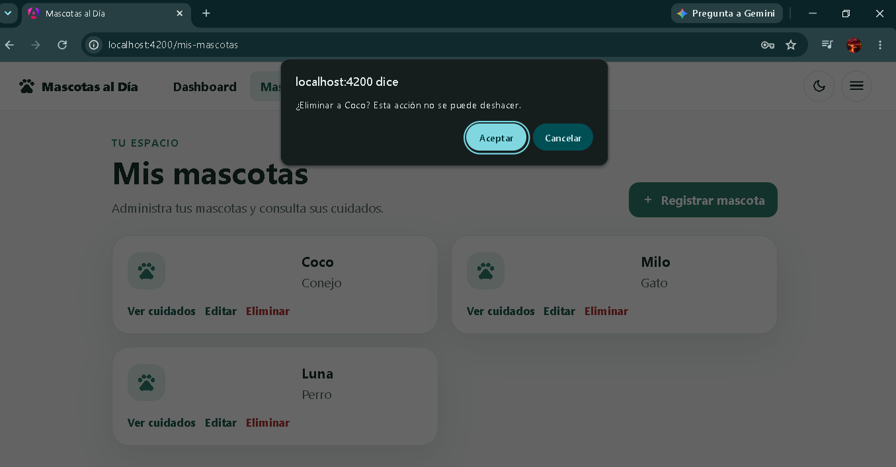
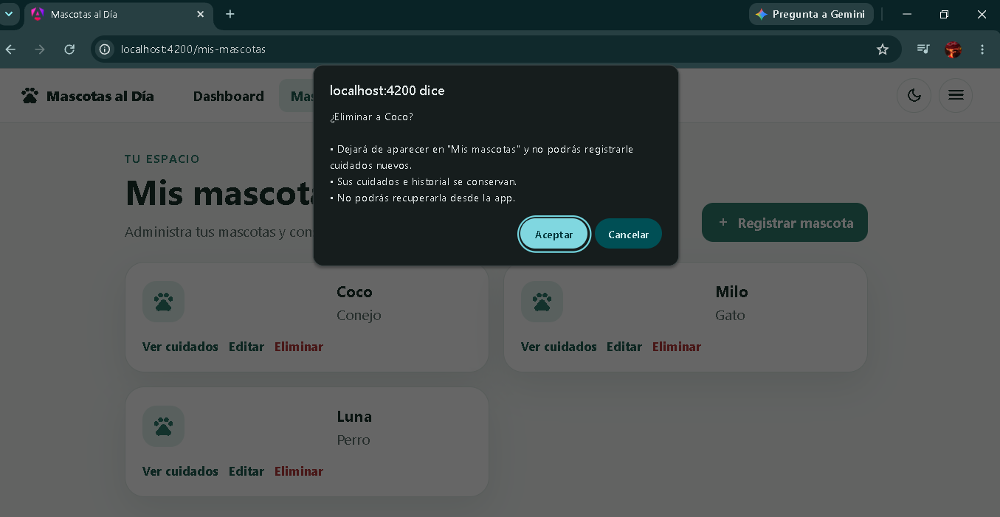

# Clase 22 · Patrones oscuros

Integrantes: Alejandro De Los Rios Aranacibia
Modalidad: sin IA

---

## 1. Patrón encontrado

**Tipo (de los seis):** Honestidad

**Dónde:** pantalla *Mis mascotas* (`/mis-mascotas`) · `frontend/src/app/pages/my-pets/my-pets.page.ts:227` (método `deletePet`, llamada a `confirm(...)`).

**Por qué es un patrón oscuro:** al eliminar una mascota, la confirmación solo decía *"¿Eliminar a Luna? Esta acción no se puede deshacer."*. El usuario no ve qué pasa con lo que depende de esa mascota, y el mensaje además no describe lo que realmente ocurre: el backend hace un borrado lógico (`PetService.delete` solo marca `deletedAt`), la mascota desaparece de *Mis mascotas*, no se le pueden crear cuidados nuevos, pero **sus cuidados e historial siguen existiendo** y siguen apareciendo en *Cuidados*. Quien confirma decide a ciegas: puede creer que perdió todo su historial, o que los cuidados pendientes de esa mascota desaparecieron, cuando siguen ahí.
No beneficia a nadie de forma intencional (no hay presión comercial ni de retención): es una confirmación irreversible que no informa el alcance real de la acción, un riesgo de diseño más que manipulación deliberada.

---

## 2. Antes

**Captura:**



**Código** (`my-pets.page.ts`, método `deletePet`):

```ts
if (!confirm(`¿Eliminar a ${pet.name}? Esta acción no se puede deshacer.`)) {
  return;
}
```

---

## 3. Después

**Captura:**



**Código:**

`frontend/src/app/pages/my-pets/delete-pet-message.ts` (nuevo):

```ts
export function deletePetConfirmMessage(petName: string): string {
  return [
    `¿Eliminar a ${petName}?`,
    '',
    '• Dejará de aparecer en "Mis mascotas" y no podrás registrarle cuidados nuevos.',
    '• Sus cuidados e historial se conservan.',
    '• No podrás recuperarla desde la app.',
  ].join('\n');
}
```

`my-pets.page.ts` (`deletePet`):

```ts
if (!confirm(deletePetConfirmMessage(pet.name))) {
  return;
}
```

La confirmación sigue siendo **una sola**: no se agregó un "¿Seguro?" de más.

**Commit:** `fix(etica): explicar el alcance real al eliminar una mascota` — hash: `PEGAR_HASH`

---

## 4. Principio aplicado

**Principio:** Nielsen #5, Prevención de errores: lo irreversible debe decir con claridad qué hace antes de que el usuario confirme. Se apoya en *La interfaz dice la verdad*: lo que el texto afirma debe coincidir con lo que el sistema hace.

**Cómo lo cumple el después:** el diálogo ahora lista las consecuencias concretas (qué desaparece, qué se conserva y que no hay recuperación desde la app), de modo que el usuario confirma sabiendo el alcance. Además deja de afirmar algo impreciso: ya no dice solo "no se puede deshacer", sino exactamente qué se pierde y qué no. No usa lenguaje culpabilizador ni agrega pasos extra.

**Limitación:** el diálogo sigue siendo el `confirm()` nativo, cuyos botones dicen "Aceptar/Cancelar" y no se pueden renombrar. Una mejora futura es un diálogo propio con botones "Eliminar a Luna" y "Conservar".