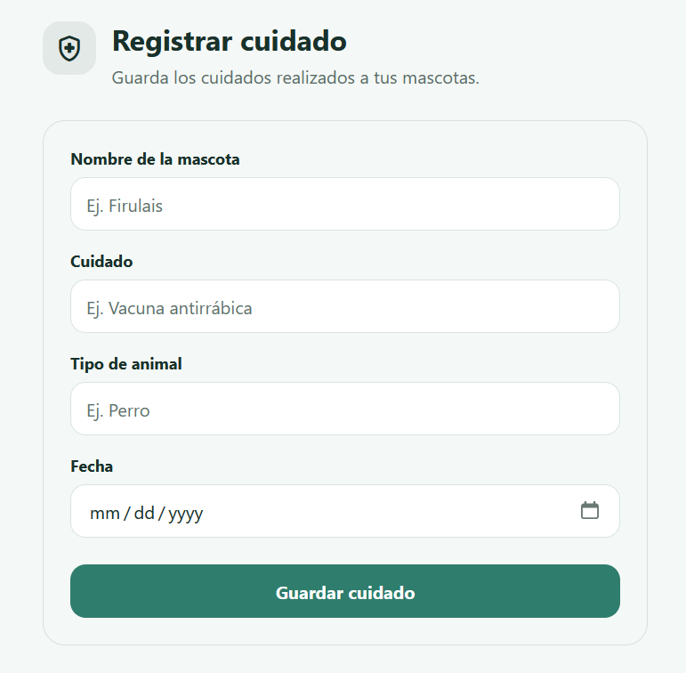
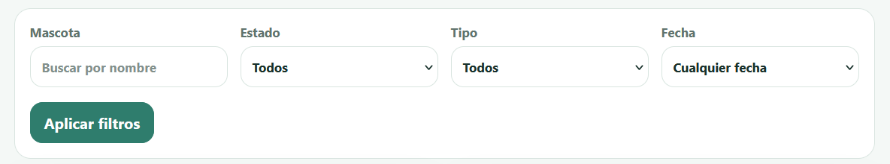
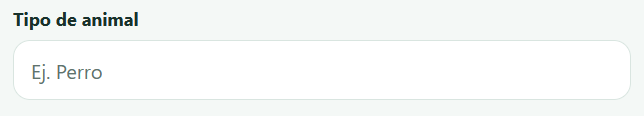

## Fitts

No existe un boton de cancelar/atras en la pantalla de creacion de cuidado

## Hick

4 filtros es demasiado, deberiamos reducirlo a los dos mas importantes (Fecha y Nombre) y los demas desplegarlos solo luego de pulsar "Mostrar mas"

## Carga Cognitiva

Al crear o modificar un cuidado, la opcion de tipo de animal deberia ser un desplegable entre animales domesticos comunes (perro, gato, loro, etc)