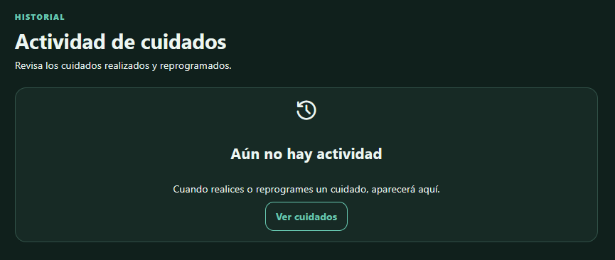
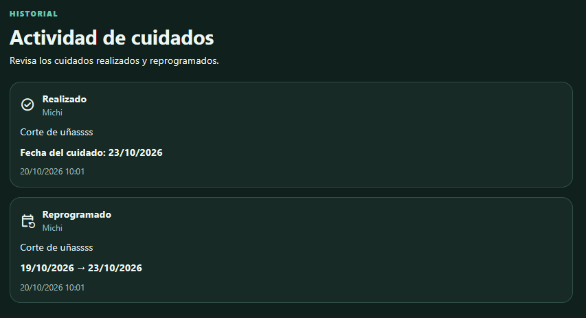
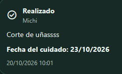

# Historial de cuidados

Se agregó una nueva funcionalidad para consultar el historial de acciones importantes sobre los cuidados.

El historial registra cuidados marcados como **Realizado** y cuidados **Reprogramados**

## Fitts

Cuando todavía no existen eventos, el estado vacío presenta una acción visible **Ver cuidados**, facilitando el acceso directo al lugar donde la persona puede realizar una acción que genere actividad en el historial

### Código relacionado

- `frontend/src/app/pages/care-history/care-history.page.html`
- `frontend/src/app/pages/care-history/care-history.page.css`

## Hick

El historial presenta directamente los eventos ordenados cronológicamente y distingue únicamente las acciones relevantes: **Realizado** y **Reprogramado**

Se evita agregar filtros, categorías o acciones innecesarias que aumenten la cantidad de decisiones para consultar el historial

### Código relacionado

- `frontend/src/app/pages/care-history/care-history.page.html`
- `frontend/src/app/pages/care-history/care-history.page.ts`

## Carga cognitiva

Cada evento muestra en el mismo lugar la mascota, el cuidado, el tipo de acción y las fechas relacionadas

En una reprogramación se muestran tanto la fecha anterior como la nueva, evitando que la persona tenga que recordar el estado previo del cuidado

### Código relacionado

- `frontend/src/app/pages/care-history/care-history.page.html`
- `frontend/src/app/models/care-history.model.ts`